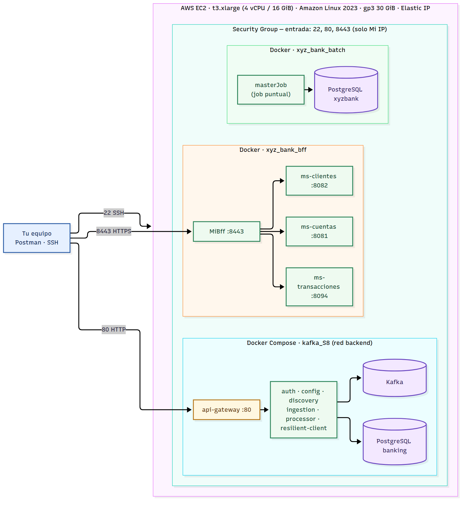

# Despliegue en AWS EC2

Este documento explica cómo desplegar en una sola instancia EC2 los tres sistemas de la solución del Banco XYZ:

| Sistema | Qué levanta | Acceso desde fuera |
|---|---|---|
| [kafka_S8](https://github.com/CarlosJRF/kafka_S8) | Config Server, Eureka, Auth Server OAuth2, API Gateway, ingesta y procesamiento sobre Kafka, Resilience4j, PostgreSQL | API Gateway en el puerto 80 |
| [xyz_bank_bff](https://github.com/CarlosJRF/xyz_bank_bff) | `MiBff` y los microservicios `ms-cuentas`, `ms-transacciones` y `ms-clientes` | BFF por HTTPS en el puerto 8443 |
| [xyz_bank_batch](https://github.com/CarlosJRF/xyz_bank_batch) | PostgreSQL y el job Spring Batch (`masterJob`) | Ninguno (se consulta por SSH) |

Todo se ejecuta en contenedores Docker. Las imágenes se compilan en la propia instancia (Dockerfile multietapa), así que no hace falta instalar Java ni Maven. El script [`deploy/ec2-setup.sh`](../deploy/ec2-setup.sh) automatiza la preparación del servidor, el arranque de los tres sistemas y las pruebas de humo.



## 1. Requisitos

- Una cuenta de AWS con permiso para lanzar instancias EC2 y crear Security Groups.
- Un par de claves (`.pem`) para conectarte por SSH.
- Tu IP pública, para limitar el acceso (en la consola aparece como "My IP").
- Los tres repositorios son públicos, por lo que la instancia los clona sin credenciales.

## 2. Crear la instancia

En la consola de EC2, **Launch instance**:

| Campo | Valor |
|---|---|
| Name | `xyz-bank` |
| AMI | **Amazon Linux 2023**, arquitectura 64-bit (x86). También sirve el parámetro SSM `/aws/service/ami-amazon-linux-latest/al2023-ami-kernel-default-x86_64` |
| Tipo de instancia | **t3.xlarge** (4 vCPU, 16 GiB). Ver "Dimensionamiento" más abajo |
| Par de claves | El que creaste para esta práctica |
| Red | VPC por defecto, subred pública, **Auto-assign public IP: Enable** |
| Almacenamiento | **30 GiB gp3** (las imágenes y la caché de build ocupan unos 12 GB; los 8 GiB por defecto no alcanzan) |
| Security Group | Uno nuevo, con las reglas de la sección siguiente |
| Elastic IP (opcional) | Evita que la IP pública cambie al detener y volver a encender la instancia |

En Amazon Linux 2023 el usuario de SSH es `ec2-user`. La AMI exige IMDSv2 por defecto y el script lo soporta (solo lo usa para mostrar la IP pública al final).

### Security Group: reglas de entrada

| Puerto | Protocolo | Origen | Para qué |
|---|---|---|---|
| 22 | TCP | Mi IP (/32) | SSH |
| 80 | TCP | Mi IP (/32) | API Gateway de `kafka_S8` |
| 8443 | TCP | Mi IP (/32) | `MiBff` por HTTPS |

- **No abras ningún otro puerto.** `ms-cuentas` (8081), `ms-clientes` (8082) y `ms-transacciones` (8094) no tienen autenticación propia y solo deben ser accesibles desde el BFF, dentro de la red de Docker. Tampoco se exponen Config Server, Eureka, Kafka ni PostgreSQL.
- Las reglas de salida se dejan por defecto (todo permitido): la instancia las necesita para descargar paquetes, imágenes y dependencias Maven.
- Si debes dejar que otra persona pruebe la instancia en vivo, cambia el origen de los puertos 80 y 8443 a `0.0.0.0/0` solo durante ese periodo, y cambia antes los secretos por defecto de `kafka_S8` (sección 7).
- Si tu IP cambia (por ejemplo, al reconectarte a otra red), actualiza las reglas, de lo contrario SSH y Postman dejarán de responder.

### Dimensionamiento

Con los tres sistemas en ejecución, en las pruebas de este despliegue (4 vCPU, 16 GiB, ver la sección 8):

- Los 14 contenedores usan en conjunto unos **2,9 GiB** (cada servicio Spring Boot entre 140 y 340 MiB, con un límite de 512 MiB; Kafka unos 470 MiB).
- El equipo completo, con el sistema operativo y Docker, tenía unos **3,7 GiB** en uso, y llegó a unos **3,9 GiB** mientras se construían las imágenes de los 12 servicios.

Con esas cifras, **`t3.xlarge`** (4 vCPU, 16 GiB) deja un margen muy amplio y compila más rápido, porque los builds de Maven usan los cuatro núcleos. **`t3.large`** (2 vCPU, 8 GiB) también cubre la memoria con holgura y cuesta la mitad, pero no se probó con 2 vCPU: el despliegue sería más lento. Menos de 8 GiB no es recomendable.

## 3. Desplegar

Hay dos formas de ejecutar el mismo script. Ambas dejan los repositorios en `/opt/xyz-bank`.

### Opción A: User data (se despliega al arrancar)

1. En **Advanced details → User data**, pega el contenido completo de [`deploy/ec2-setup.sh`](../deploy/ec2-setup.sh).
2. Lanza la instancia.
3. Sigue el avance por SSH:
   ```bash
   sudo tail -f /var/log/cloud-init-output.log
   ```

### Opción B: por SSH

```bash
ssh -i clave.pem ec2-user@<IP-publica>
curl -fsSL https://raw.githubusercontent.com/CarlosJRF/xyz_bank_bff/main/deploy/ec2-setup.sh -o ec2-setup.sh
sudo bash ec2-setup.sh
```

### Qué hace el script

1. Instala Docker, Git, Compose v2 y buildx (si faltan) y crea 2 GiB de swap como red de seguridad.
2. Clona los tres repositorios en `/opt/xyz-bank` (o los actualiza si ya existen).
3. Levanta `kafka_S8` con el gateway publicado en el puerto 80.
4. Levanta `xyz_bank_bff` (BFF en el 8443).
5. Levanta PostgreSQL de `xyz_bank_batch` y ejecuta `masterJob` una vez.
6. Ejecuta tres pruebas de humo y muestra las URL de acceso. Termina con código distinto de cero si alguna falla.

Al finalizar, la salida debe terminar así:

```
==> Smoke tests
  OK     kafka_S8: token OAuth2 y GET /api/stats por el gateway (:80)
  OK     xyz_bank_bff: canales web, móvil y cajero con datos de cuenta
  OK     xyz_bank_batch: transacciones persistidas en PostgreSQL
==> Ready
```

### Variables opcionales

Se pasan antes del comando, por ejemplo `sudo STACKS="kafka bff" bash ec2-setup.sh`.

| Variable | Por defecto | Efecto |
|---|---|---|
| `STACKS` | `kafka bff batch` | Sistemas a levantar |
| `BRANCH` | `main` | Rama que se despliega en los tres repositorios |
| `GATEWAY_PORT` | `80` | Puerto público del gateway de `kafka_S8` |
| `RUN_BATCH` | `true` | Ejecuta `masterJob` tras levantar PostgreSQL |
| `SWAP_MB` | `2048` | Tamaño del swap; `0` lo omite |
| `APP_ROOT` | `/opt/xyz-bank` | Carpeta donde se clonan los repositorios |
| `GITHUB_USER` | `CarlosJRF` | Propietario de los repositorios |

Ejecutar el script de nuevo es seguro: actualiza el código, reconstruye las imágenes, vuelve a ejecutar el batch (que recarga sus tablas) y repite las pruebas.

## 4. Verificar

> **Importante:** Si `docker` responde `permission denied ... /var/run/docker.sock`, tu sesión SSH es anterior a la instalación: el script agrega a `ec2-user` al grupo `docker`, pero ese grupo solo aplica a sesiones nuevas. Ejecuta `newgrp docker` en esa terminal, vuelve a conectarte por SSH, o antepón `sudo` a cada `docker`.

Desde la instancia:

```bash
cd /opt/xyz-bank
for d in kafka_S8 xyz_bank_bff xyz_bank_batch; do (cd $d && docker compose ps); done
docker stats --no-stream
```

Todos los servicios deben figurar como `healthy` (el job del batch no aparece: termina al acabar).

## 5. Probar desde Postman

### BFF (HTTPS, puerto 8443)

El certificado es autofirmado: en Postman, **Settings → General → SSL certificate verification: Off**.

| Canal | Petición | Autenticación Basic |
|---|---|---|
| Web | `GET https://<IP-publica>:8443/api/web/cuentas/101` | `clienteWeb` / `web123` |
| Móvil | `GET https://<IP-publica>:8443/api/movil/cuentas/101` | `clienteMovil` / `movil123` |
| Cajero | `GET https://<IP-publica>:8443/api/cajero/cuentas/101/saldo` | `atmXyz` / `atm123` |

Sin credenciales responde 401, y con el usuario de otro canal responde 403.

### Plataforma `kafka_S8` (OAuth2, puerto 80)

1. **Obtener el token:** `POST http://<IP-publica>/oauth2/token`, Authorization Basic `banking-client` / `banking-secret`, cuerpo `x-www-form-urlencoded` con `grant_type=client_credentials` y `scope=data.read ingestion.write`.
2. **Ejecutar la ingesta:** `POST http://<IP-publica>/api/ingestion/run` con `Authorization: Bearer <token>`. Lee los tres CSV, publica en Kafka y responde un informe por archivo (en la prueba: 1.552 filas aceptadas y 1.448 rechazadas).
3. **Consultar:** `GET /api/stats`, `GET /api/accounts` y `GET /api/accounts/{id}/summary`, con el mismo token.

Sin token, el gateway responde 401.

### Resultados del batch

```bash
cd /opt/xyz-bank/xyz_bank_batch
docker compose exec postgres psql -U xyzbank -d xyzbank \
  -c "SELECT step_name, action, error_code, COUNT(*) FROM data_quality_log GROUP BY 1,2,3 ORDER BY 1,2,4 DESC;"
```

Para ejecutar el job de nuevo: `docker compose run --rm batch`. Cada ejecución recarga las tablas, por lo que el resultado es el mismo (392 transacciones, 320 cuentas y 603 estados anuales persistidos).

### Paneles internos

Eureka (8761), Config Server (8888) y los endpoints de Resilience4j (8083) solo escuchan en `127.0.0.1` de la instancia. Para verlos, abre un túnel SSH:

```bash
ssh -i clave.pem -L 8761:localhost:8761 -L 8083:localhost:8083 ec2-user@<IP-publica>
```

Después abre `http://localhost:8761` (Eureka) y `http://localhost:8083/actuator/circuitbreakers`.

## 6. Escalabilidad horizontal

Los servicios de `kafka_S8` se registran en Eureka y el gateway los balancea con `lb://`, por lo que se pueden replicar:

```bash
cd /opt/xyz-bank/kafka_S8
docker compose up -d --scale data-processor-service=2 --no-recreate --wait
```

En Eureka (`http://localhost:8761` con el túnel) aparecen dos instancias de `DATA-PROCESSOR-SERVICE` en estado `UP`. Esta técnica aplica a `kafka_S8`; el BFF consulta a sus microservicios por URL fija, así que replicarlos requeriría registrarlos antes en Eureka (próximo paso en `readme.md`).

## 7. Seguridad

- **Acceso:** deja el Security Group abierto solo a tu IP. Es la medida principal, porque los microservicios internos no tienen autenticación propia.
- **Secretos por defecto:** `kafka_S8` crea su `.env` desde `.env.example` con secretos de ejemplo (`banking-secret`, `resilient-secret`, claves de PostgreSQL). Si abres la instancia a Internet, cámbialos en `/opt/xyz-bank/kafka_S8/.env` y ejecuta `docker compose up -d` en esa carpeta.
- **Credenciales del BFF:** los usuarios `clienteWeb`, `clienteMovil` y `atmXyz` están definidos en el código del repositorio (que es público), por lo que sirven para una demostración, no para producción.
- **TLS:** el BFF usa un certificado autofirmado. El gateway responde en HTTP; para HTTPS delante de él se necesitaría un proxy o un balanceador.

## 8. Resultados de la prueba del despliegue

El script se ejecutó completo en un entorno con las mismas características que la instancia recomendada (4 vCPU, 16 GiB), desde cero y con los repositorios clonados desde GitHub:

| Medición | Resultado |
|---|---|
| Pruebas de humo | Las tres en `OK` |
| Contenedores | 14, todos `healthy` |
| Memoria de los contenedores | ≈ 2,9 GiB |
| Memoria usada en el equipo | ≈ 3,7 GiB |
| Pico de memoria usada durante los builds | ≈ 3,9 GiB (muestreo cada 2 s, con los 12 servicios compilándose a la vez) |
| Disco de Docker | ≈ 7,4 GB de imágenes y ≈ 4,8 GB de caché de build |
| Duración del despliegue completo, en frío | ≈ 11 minutos (sin imágenes ni caché de build) |
| Segunda ejecución del script | Actualiza los repositorios, reconstruye y vuelve a pasar las tres pruebas |

Estas pruebas no se hicieron en una instancia EC2 real: la duración depende de la red (aquí el tráfico pasaba por un proxy) y del almacenamiento. Confirma las cifras en tu instancia con `docker stats --no-stream` y `free -m`.

## 9. Operación y costos

- **Logs:** `docker compose logs -f <servicio>` dentro de la carpeta de cada sistema.
- **Detener los sistemas:** `docker compose down` en cada carpeta (con `-v` se borran también los datos de PostgreSQL y Kafka).
- **Apagar la instancia:** detenerla (Stop) deja de cobrar el cómputo, pero el disco EBS sigue cobrándose. Eliminarla (Terminate) borra todo.
- **IP pública:** si asocias una Elastic IP, libérala al terminar; AWS cobra por hora las direcciones IPv4 públicas.
- **Costo:** enciende la instancia solo para pruebas y grabación. El precio de `t3.xlarge` es de unos US$0,17 por hora en us-east-1 (varía por región; confírmalo en la calculadora de AWS). Si tu cuenta es de AWS Academy, comprueba antes que permita el tamaño `xlarge`.

## 10. Solución de problemas

| Síntoma | Causa y solución |
|---|---|
| `permission denied ... docker.sock` | La sesión SSH es anterior al grupo `docker`: ejecuta `newgrp docker`, vuelve a conectarte o usa `sudo docker ...` |
| SSH o Postman no responden | La IP de origen cambió: actualiza la regla del Security Group con "My IP" |
| `compose build requires buildx 0.17.0 or later` | Vuelve a ejecutar el script: instala el plugin buildx |
| Un contenedor se reinicia o queda `unhealthy` | `docker compose logs <servicio>` en la carpeta del sistema; con memoria justa, revisa `free -m` y que el swap esté activo (`swapon --show`) |
| El BFF responde 200 pero `cliente` viene `null` | `ms-clientes` no respondió o el titular no existe (por ejemplo las cuentas con titular "Unknown"); el canal se degrada a propósito |
| El script falla en una prueba de humo | Muestra qué sistema falló; revisa los logs de ese `docker compose` |
