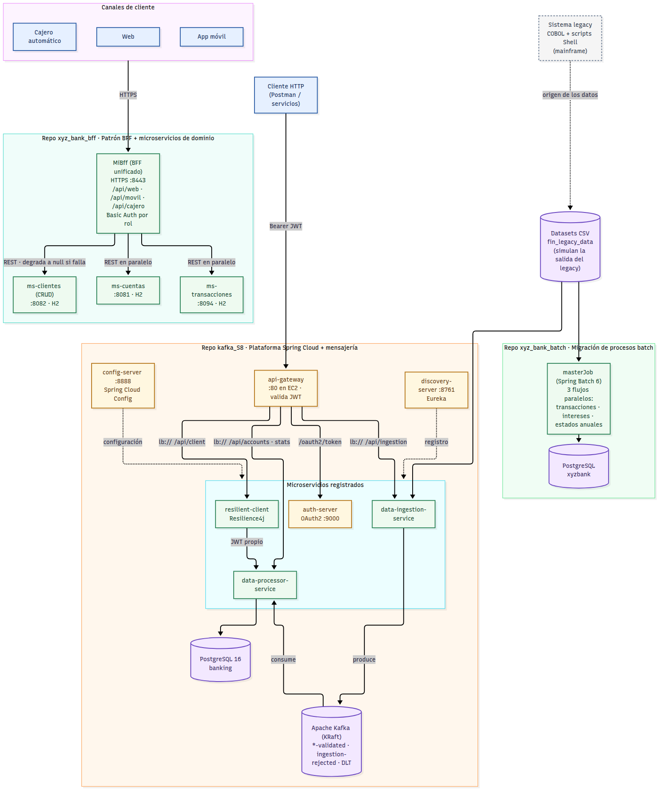

# Banco XYZ — Modernización del sistema legacy a microservicios

Evaluación Final Transversal · Desarrollo Backend III (PBY2203) · Entrega individual

Este documento es el punto de entrada de la entrega. La solución se compone de **tres repositorios** que
resuelven partes distintas del caso del Banco XYZ (plataforma legacy en COBOL y scripts Shell sobre
mainframe) y que, en conjunto, cubren las tres partes del encargo: migración de procesos batch,
patrón Backend for Frontend y microservicios resilientes con Spring Cloud.

## 1. Repositorios

| Repositorio | Parte del encargo | Contenido principal |
|---|---|---|
| [xyz_bank_batch](https://github.com/CarlosJRF/xyz_bank_batch) | Parte 1 · Migración de procesos batch | Spring Batch 6: `masterJob` con 3 flujos paralelos (transacciones diarias, intereses, estados de cuenta anuales), validación por tipo de error, skip/retry, bitácora de calidad de datos y benchmark |
| [xyz_bank_bff](https://github.com/CarlosJRF/xyz_bank_bff) | Parte 2 · Patrón BFF (y microservicios de dominio) | `MiBff` (BFF para web, móvil y cajero) y los microservicios `ms-cuentas`, `ms-transacciones` y `ms-clientes` |
| [kafka_S8](https://github.com/CarlosJRF/kafka_S8) | Parte 3 · Microservicios resilientes con Spring Cloud | Config Server, Eureka, Auth Server OAuth2, API Gateway, Resilience4j, ingesta/procesamiento sobre Kafka, Docker Compose y script de despliegue en EC2 |

## 2. Arquitectura global



*Fuente editable: [`diagramas/arquitectura-global.mmd`](diagramas/arquitectura-global.mmd) (Mermaid).*

Cómo leer el diagrama:

- **Canales → BFF.** Web, móvil y cajero llaman a `MiBff` por HTTPS (:8443). El BFF consulta en paralelo
  a `ms-cuentas` y `ms-transacciones`, y luego a `ms-clientes` (el titular se busca por el nombre que
  trae la cuenta). Cada canal recibe una respuesta distinta, armada a su medida.
- **Clientes HTTP → API Gateway.** En `kafka_S8` la entrada única es el gateway, que valida el JWT emitido
  por el `auth-server` y enruta con `lb://` usando Eureka. La configuración de todos los servicios la
  sirve el `config-server`.
- **Pipeline de eventos.** `data-ingestion-service` lee los CSV, valida y normaliza cada fila y la publica en
  Kafka; `data-processor-service` la consume, la persiste en PostgreSQL (upsert idempotente) y expone
  las consultas. `resilient-client` consulta al processor protegido con Resilience4j.
- **Batch.** `xyz_bank_batch` es una aplicación independiente que procesa los tres archivos del legado y
  deja los resultados y la bitácora de rechazos en su propia base PostgreSQL.

### Puertos

| Sistema | Componente | Puerto |
|---|---|---|
| xyz_bank_bff | MiBff (HTTPS) | 8443 |
| xyz_bank_bff | ms-cuentas · ms-clientes · ms-transacciones | 8081 · 8082 · 8094 |
| kafka_S8 | api-gateway (publicado) | 8080 (80 en EC2) |
| kafka_S8 | config-server · discovery-server · auth-server | 8888 · 8761 · 9000 |
| kafka_S8 | data-ingestion · data-processor · resilient-client | 8081 · 8082 · 8083 (solo red Docker) |
| kafka_S8 | Kafka · PostgreSQL | 9092 · 5432 (red Docker; Kafka expone además el 9094 solo en 127.0.0.1) |
| xyz_bank_batch | PostgreSQL local | 5432 |

Los puertos 8081 y 8082 se repiten entre `xyz_bank_bff` y `kafka_S8`, pero en `kafka_S8` esos servicios
no se publican en el host (viven dentro de la red Docker `backend`), por lo que no hay conflicto.

## 3. Cómo se integran los componentes

| Interacción | Mecanismo | Estado |
|---|---|---|
| MiBff → ms-cuentas / ms-transacciones / ms-clientes | REST síncrono (`RestClient`), llamadas en paralelo con `CompletableFuture`, timeouts de 5 s / 10 s | Operativo |
| MiBff → ms-clientes ante falla | El canal responde igual con el cliente en `null` y registra una advertencia | Operativo |
| Gateway → servicios de `kafka_S8` | `lb://` con Eureka, JWT validado en gateway y en cada servicio | Operativo |
| data-ingestion → Kafka → data-processor | Topics `*-validated`, `ingestion-rejected` y `.DLT`; productor idempotente, consumidor con 3 reintentos y dead-letter | Operativo |
| resilient-client → data-processor | Circuit Breaker, Retry y Rate Limiter con fallback | Operativo |
| xyz_bank_batch → PostgreSQL | Jobs Spring Batch con chunks, skip y retry | Operativo |
| MiBff ↔ plataforma de `kafka_S8` (OAuth2, Eureka, Config) | — | Pendiente (ver sección 7) |
| ms-transacciones → Kafka (evento de transacción completada) | — | Pendiente (ver sección 7) |

Los tres repositorios son hoy sistemas desacoplados que comparten el mismo caso de negocio y los mismos
datasets de origen. La integración entre ellos queda planteada como evolución en la sección 7.

## 4. Cobertura del encargo

### Procesos clave identificados para la migración

| Proceso clave | Dónde está resuelto |
|---|---|
| Migración de procesos batch a Spring Batch | `xyz_bank_batch` |
| División del sistema monolítico en microservicios | `xyz_bank_bff` (cuentas, transacciones, clientes) y `kafka_S8` (ingesta, procesamiento) |
| Implementación del patrón BFF | `xyz_bank_bff` · `MiBff` |
| Seguridad distribuida con Spring Cloud Security | `kafka_S8` · `auth-server` + `api-gateway` (OAuth2, JWT) |
| Mensajería asíncrona con Apache Kafka | `kafka_S8` · `data-ingestion-service` y `data-processor-service` |

### Dónde verificar cada requerimiento

| Requerimiento del encargo | Evidencia |
|---|---|
| Procesos batch con manejo de errores, reintentos y paralelismo | `xyz_bank_batch`: README (resiliencia, dimensionamiento de hilos, benchmark) y tests de integración |
| BFF Web, Móvil y Cajero con seguridad por canal | `xyz_bank_bff/MiBff`: `/api/web`, `/api/movil`, `/api/cajero`, HTTPS y roles `WEB`, `MOVIL`, `CAJERO` |
| Microservicio de Gestión de Cuentas | `xyz_bank_bff/ms-cuentas` |
| Microservicio de Procesamiento de Pagos | `xyz_bank_bff/ms-transacciones` (consulta de movimientos; el registro de pagos es parte de la sección 7) |
| Microservicio de Gestión de Clientes | `xyz_bank_bff/ms-clientes` (CRUD de perfiles) |
| Spring Cloud Config, Eureka, balanceo y enrutamiento | `kafka_S8`: `config-server`, `discovery-server`, `api-gateway` |
| OAuth2 para proteger endpoints | `kafka_S8`: `auth-server` (Client Credentials, scopes `data.read` e `ingestion.write`) |
| Resilience4j y comportamiento alternativo | `kafka_S8`: `resilient-client`; `docs/evidencia/circuit-breaker.txt` |
| Tópicos, productores y consumidores | `kafka_S8`: `docs/evidencia/kafka-topics.txt` y `demo-end-to-end.txt` |
| Docker Compose y preparación para AWS | `kafka_S8`: `docker-compose.yaml` y `deploy/ec2-setup.sh`; ver `despliegue.md` |

## 5. Del legacy a la nueva arquitectura

| Aspecto | Sistema legacy | Solución actual |
|---|---|---|
| Procesos batch | Programas COBOL y scripts Shell en mainframe | Spring Batch 6 con tres jobs, chunks de 100 registros, skip y retry; re-ejecutable y con bitácora de rechazos (`data_quality_log`) |
| Rendimiento batch | — | 3.000 registros en una mediana de 738 ms (4 vCPU); la configuración elegida es ~35 % más rápida que la inicial (detalle en el benchmark del repo) |
| Arquitectura | Monolito | Microservicios independientes, cada uno con su propio ciclo de despliegue |
| Respuesta a los frontends | Los mismos datos para todos | BFF por canal: la web recibe perfil, movimientos y resumen; el móvil, el titular y los 5 últimos movimientos; el cajero, solo saldo y titular enmascarado (ej. "Charlie G.") |
| Seguridad | Centralizada y limitada | JWT OAuth2 con scopes en la plataforma; HTTPS y roles por canal en el BFF |
| Tolerancia a fallos | Un módulo caído afecta a todo el sistema | Circuit breaker, reintentos, rate limiter, dead-letter queue y degradación controlada en el BFF |
| Calidad de datos | — | Cada fila rechazada queda registrada con todos sus motivos. `xyz_bank_batch`: 1.315 persistidas y 1.685 rechazadas de 3.000. `kafka_S8`: 1.552 aceptadas y 1.448 rechazadas de 3.000. Las cifras difieren porque cada repositorio aplica reglas propias (por ejemplo, rango de edad 18–99 frente a 18–120) |
| Despliegue | Servidores mainframe | Contenedores Docker; plataforma lista para una instancia EC2 |

No se dispone de mediciones del sistema legacy, por lo que la comparación de esta tabla es cualitativa,
salvo las cifras de los propios repositorios.

## 6. Seguridad por componente

| Componente | Autenticación y autorización | Transporte |
|---|---|---|
| MiBff | HTTP Basic con usuarios en memoria (`clienteWeb`, `clienteMovil`, `atmXyz`); cada prefijo `/api/web`, `/api/movil` y `/api/cajero` exige su rol | HTTPS (:8443) con keystore PKCS12 |
| ms-cuentas, ms-transacciones, ms-clientes | Sin autenticación propia; pensados para quedar accesibles solo desde el BFF | HTTP, red interna |
| api-gateway y servicios de `kafka_S8` | JWT OAuth2 (Client Credentials, RSA), validado en el gateway y de nuevo en cada servicio | HTTP :80 (TLS opcional con un proxy o ALB delante) |
| xyz_bank_batch | No expone endpoints | Conexión a PostgreSQL |

## 7. Alcance actual y próximos pasos

1. **BFF sobre OAuth2.** Convertir `MiBff` en Resource Server que valide los JWT del `auth-server`, en lugar de Basic Auth con usuarios en memoria.
2. **Pagos y eventos.** Agregar a `ms-transacciones` el registro de pagos, transferencias y depósitos, publicando el evento "transacción completada" en Kafka para que lo consuma la plataforma.
3. **Vínculo cuenta–cliente.** `ms-cuentas` no guarda un `clienteId`: hoy el BFF resuelve al titular por nombre. Agregar la clave del cliente a la cuenta.
4. **Descubrimiento y configuración.** Registrar los microservicios de `xyz_bank_bff` en Eureka y leer su configuración del Config Server, en vez de URLs fijas.
5. **Contenedores.** `xyz_bank_bff` y `xyz_bank_batch` se ejecutan hoy con Maven o JAR; falta su Dockerfile y un Compose para desplegar los tres sistemas juntos (`kafka_S8` ya está contenerizado).
6. **Un solo pipeline de datos.** Batch e ingesta Kafka procesan los mismos tipos de archivo con reglas distintas; unificar criterios de validación y destino.

## 8. Contenido de la entrega

```
entrega/
├── readme.md                  Este documento
├── diagramas/                 Diagramas de arquitectura y de despliegue (.mmd, .svg, .png)
├── informe-tecnico.pdf        Informe técnico (plantilla PBY2203_EFT_S9_plantilla_PDF)
├── instrucciones.md           Cómo ejecutar y probar cada componente
├── despliegue.md              Pasos para desplegar en la nube (AWS EC2)
└── video-presentacion.mp4     Presentación de 5 a 7 minutos
```
